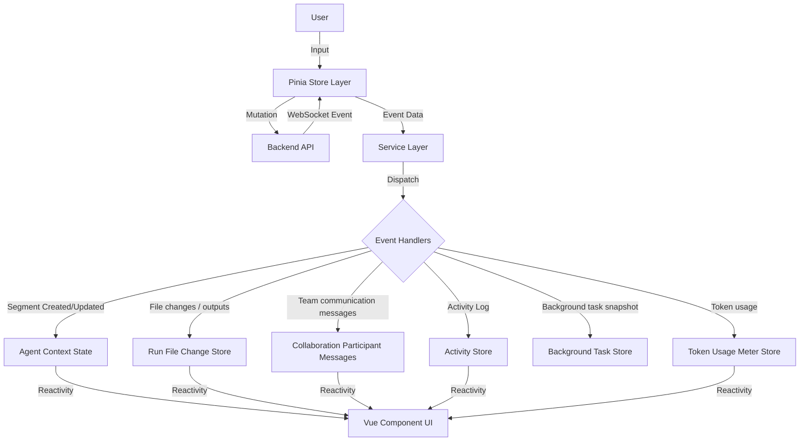

# Settings

## Overview

This document describes the Settings pages and the server, runtime and node settings behind them (provider credentials, server settings, nodes, notifications, agent runtimes, model routing, agent packages), and how a saved run's configuration is shown and changed (Existing Run Configuration). How Agent, Agent Team and Agent Org executions run in the frontend is in [Agent Execution Architecture](./agent_execution_architecture.md).

## Provider Credential Settings

Settings -> API Key Management is a write-only credential surface backed by the
server's centralized encrypted vault:

- `providerCredentialSettings(runtimeKind)` returns each provider once with its
  descriptor, `catalogMode = STATIC | DISCOVERED`, and one provider-owned
  `apiKeyConfigured` fact. It does not read or wait for model discovery;
- `providerModelCatalogSnapshots(runtimeKind)` independently returns the
  current in-process LLM, audio, image, and video rows plus source state. The
  snapshot read initializes curated/static registries without network access
  and never starts a dynamic source;
- stored credential values are never returned;
- ordinary built-in providers support Save/create-or-overwrite and value-free
  configured status, with no standalone credential-removal action;
- Gemini uses its specialized three-option Settings flow for Save/overwrite,
  first-time Save-and-use, and Use-this-mode;
- Gemini initially renders three compact option rows. Configure expands and
  focuses exactly one editor at a time. Key inputs remain write-only password
  fields, the visibility control affects only the transient typed value, and a
  successful save clears that input;
- Qwen uses a dedicated Base URL + API-key form rather than the ordinary
  built-in key-only editor. Both values are required; the URL must be absolute
  HTTP(S), and the server probes its `/models` contract before persistence. The
  key stays write-only and is cleared after a successful committed mutation;
- Qwen renders the server-owned `DEFAULT` or `CONFIGURED` endpoint source and
  value-free key status. It never infers configured state by comparing the
  effective URL with a frontend default. A failed durable URL commit reports
  that the previous pair was restored; the bounded double-failure result tells
  the user to save a valid pair again before using Qwen;
- configured and active state are value-free badges derived from the
  authoritative setup state and remain accurate after a Settings reload; and
- successful credential/setup commands return the updated value-free setting
  (and specialized Gemini/Qwen setup state) so the client applies committed
  state directly without refetching or awaiting a catalog operation. The
  frontend credential store copies credential-query rows into a store-owned
  array and publishes a replacement array for each returned setting; it must
  not mutate Apollo's read-only result or an earlier published array. This
  keeps successful saves from being mislabeled as failures after the server
  has committed, while rejected saves leave the prior configured status intact.

API Keys starts the credential read and local catalog snapshot independently,
but it awaits only the credential read before rendering provider navigation and
the selected credential editor. Static providers show curated rows immediately
and never show Reload. `OLLAMA`, `LMSTUDIO`, and saved custom
providers are `DISCOVERED`: selecting a cold source starts only that provider's
`ensureProviderModelCatalog` operation. A later read reuses its in-process
snapshot; only provider-local Reload forces `reloadProviderModelCatalog`. There
is no page-level, global, static-provider, or all-capability Reload operation.

Dynamic progress and failure stay inside the selected model section. Source
state distinguishes `IDLE`, `LOADING`, `READY`, `PARTIAL`, `REFRESHING`,
`STALE_ERROR`, and `ERROR`. Credential controls remain available during model
loading/failure; current rows remain visible while refreshing; retained rows
use stale copy only after their own failed refresh; and a partial response with
no rows is unavailable/partial rather than an authoritative empty catalog.

A successful Qwen mutation is the committed setup result. The client then
applies the returned setup and credential setting directly. Qwen's static
catalog (`qwen3.7-max`, `qwen3.8-max`, `deepseek-v4-pro`,
`deepseek-v4-flash-0731`, `glm-5.2`, and `qwen3-max`) does not require endpoint
discovery or Reload. Catalog rows show the friendly names `DeepSeek V4 Pro (Qwen)`,
`DeepSeek V4 Flash 0731 (Qwen)`, and `GLM-5.2 (Qwen)` across Settings and the
shared agent, team, application/member, and binding selection paths. Their
option values remain the collision-safe `qwen:...` model identifiers, and Qwen
provider requests continue to send the exact unprefixed model values. A stored
selector missing from the current catalog remains visible by its raw identifier
for repair instead of receiving a guessed friendly name. If a subordinate
operation fails, the UI keeps the committed configured state rather than
relabeling the save as failed. The removed `qwen3.8-max-preview` value must not
reappear after save, catalog read, or recovery.

A built-in provider credential save returns after the vault commit and starts
no model-catalog operation on either side.

The remote AutoByteus LLM provider has been removed: Settings shows no
`AutoByteus` provider row and no "AutoByteus LLM Hosts" endpoint card. A saved
model selection that names one of its former models stays visible as
unavailable until the user picks another model. A leftover
`AUTOBYTEUS_LLM_SERVER_HOSTS` value appears under Server Settings as an ordinary
custom setting that can be deleted. The native AutoByteus runtime is
unaffected.

The "AutoByteus VNC Hosts" endpoint card and its `AUTOBYTEUS_VNC_SERVER_HOSTS`
setting are retired: the VNC Viewer reaches a Docker node's desktop through
the node's own server, so there is nothing to configure. A value saved
earlier shows under Server Settings as an ordinary custom setting that can be
deleted. The endpoint cards are LM Studio and Ollama.

Custom OpenAI-compatible provider drafts still accept an API key for the probe
and create transaction, but only non-secret provider metadata is persisted in
the strict V3 custom-provider JSON file. The server derives an immutable
readable ID from the normalized name (for example `provider_alibaba_cloud`) and
atomically rejects invalid names or canonical-name/ID collisions; the browser
does not submit an ID. The credential is stored separately, and deleting the
custom provider through the provider-entity lifecycle removes both its
credential and metadata.

An upgrade from legacy UUID providers deliberately resets provider records,
Base URLs, and credentials after migrating only exact allowlisted selector
prefixes. The user recreates each desired provider through the same custom
provider form with name, Base URL, and a new key. Reusing the same canonical
name regenerates the readable prefix embedded in migrated selectors; a changed
name or missing model suffix requires manual reselection. During the
provider-absent interval, saved selectors remain visible as unavailable and
block launch/resume instead of silently clearing or falling back. In
particular, application agent launch profiles retain the raw missing value and
show unavailable guidance until the user selects an advertised model.

See `autobyteus-server-ts/docs/modules/secret_management.md` for encrypted-vault,
migration, runtime resolution, Claude authentication, and real-E2E operator
contracts.

## Server Settings: Working-Context Compaction

Settings -> Server Settings -> Basics contains the node-bound Compaction card:

- trigger ratio, active-context token override and detailed logs are the card's
  settings;
- there is no compaction model choice: compaction always summarizes with the
  agent's own model, because a different model can never reuse the agent's prompt
  cache. A value saved earlier under `AUTOBYTEUS_COMPACTION_MODEL_SETTINGS` has no
  effect and is not shown on this card.

Stale node responses must not replace current drafts. A failed initial settings
read exposes Retry rather than claiming a clean usable configuration.

Save sends changed valid fields sequentially through the existing per-setting
mutation, stopping on the first failure. Prior successful writes remain saved;
failed/unsent fields stay dirty for remaining-only retry. This is not a transaction
across all controls.

There is no strategy or compactor-agent selector. The active-context token override has an explicit
public numeric-setting exception; other credential-name checks stay in force.
Old strategy settings are not imported. The retired built-in Memory Compactor's installed folder is deleted at
startup (`20261118_remove_retired_built_in_agents`); its runs stay.
The card retains full-width controls and stacked navigation on narrow screens.

See [core memory design](../../autobyteus-ts/docs/agent_memory_design.md) for
summary format, retry ownership and current storage boundaries.

## Server Migrations: Status Evidence

Settings -> Server Migrations consumes the server-owned migration-record
projection. A completed attempt exposes one nullable plain-text summary in the
canonical form `Scanned N; migrated N; skipped N; failed N.` together with its
status, attempt/timing metadata, concise error, and detailed-log path. A record
with no terminal attempt may have no summary.

The table renders that summary as opaque text; it does not parse counts, accept
the released `summary_json` shape, or expose expandable item details. The
runner's per-attempt filesystem log remains the detailed evidence destination:
it contains the four counts and every item diagnostic returned by the
migration definition, while the database, GraphQL response, store, and Settings
table stay independent of source cardinality. The displayed `logPath` is a
reference only; the frontend does not read or validate historical log files.

## Server Migrations: Recovery Actions

Settings -> Server Migrations renders recovery policy supplied by the server;
it does not derive policy from migration IDs, statuses, or execution metadata.
Each migration status carries one action:

- `MANUAL_RETRY`: Retry is enabled and dispatches the existing retry mutation;
- `RESTART_TO_RETRY`: Retry stays disabled, no mutation is dispatched, and the
  card shows localized guidance that AutoByteus must be restarted for another
  ordinary startup attempt; or
- `NONE`: no retry action or restart promise is presented.

The restart-only guidance is available in English and zh-CN. It describes the
actual startup runner path, not a frontend workaround: a failed or stale
required startup-only migration may run on the next ordinary application
startup, while direct manual execution remains unavailable. Transport and UI
state retain the non-null server action; `canRetry` remains true only for
`MANUAL_RETRY`.

## Server Settings: Live Response Streaming

Settings -> Server Settings -> Basics contains a node-bound **Live response
update interval (ms)** card. It controls the sole normal WebSocket content
cadence on the server selected by the current window; it is not a per-agent,
per-team, runtime, provider, or frontend-renderer preference.

- `getEffectiveStreamingContentFlushIntervalMs` returns the bound server's
  effective value. An absent or invalid direct configuration resolves to the
  recommended default of 500 ms without writing configuration merely because
  the card loaded.
- Save accepts only whole milliseconds from 100 through 2,000 and persists the
  canonical `AUTOBYTEUS_STREAMING_CONTENT_FLUSH_INTERVAL_MS` setting through the
  existing server-setting mutation. Reset writes 500 ms.
- A successful change affects the next newly opened content window on active
  and future streams without restarting the application or server. A window
  already in flight keeps the interval captured when it opened.
- The value configures the pipeline's one content scheduler only. The same
  per-connection pipeline also forwards first/changed `AGENT_STATUS` payloads
  and suppresses exact repeats by enriched standalone/member/task identity;
  that status policy is not a user-tunable cadence setting. Reconnect creates a
  fresh status baseline, and canonical runtime subscribers remain unfiltered.
- Smaller values display live progress more frequently; larger values reduce
  transport and UI update work. The frontend adds no second cadence timer.
- Loading, mutation, validation, and unavailable-node failures remain explicit.
  Rebinding the window reads the newly bound server's effective value, so two
  nodes can legitimately retain different settings without cross-node leakage.

## Server Settings: Context File Size Limits

Two node settings bound the size of a context file (a file attached to a message or a Project
Task); terms are in [GLOSSARY.md](../../GLOSSARY.md) "Context Files".

| Setting | Applies to | Default | Allowed |
| --- | --- | --- | --- |
| `AUTOBYTEUS_CONTEXT_FILE_AUDIO_VIDEO_MAX_MB` | audio and video files (the audio/video limit) | 2048 (2 GiB) | whole MiB, 1–10240 |
| `AUTOBYTEUS_CONTEXT_FILE_OTHER_MAX_MB` | every other accepted file, images and documents included (the other-file limit) | 25 | whole MiB, 1–1024 |

- They are ordinary predefined server settings: set them as environment variables or in Settings ->
  Server Settings. A predefined setting that has no value is not listed (the node uses its default),
  so on a node that never set them the owner adds each key with the advanced list's new-setting row;
  once it has a value it is listed with its description. The server refuses an invalid value on save
  and uses the default for an invalid value that is already present.
- A change applies to the next upload on that node without a restart; the composer reads the
  limits at each pick (`GET /rest/context-files/size-limits`), so it needs no reload either.
- Disk use grows with large videos: lower the audio/video limit to cap it. Draft uploads of any size
  are removed after 24 hours if never sent.
- The native AutoByteus runtime does not send a local media file larger than 25 MiB inline in a
  model request, whatever these limits are; the agent opens it from its path.

## Server Settings: Claude Runtime

Settings -> Server Settings -> Basics contains a node-bound **Claude runtime**
card (`components/settings/ClaudeRuntimeCard.vue`), placed after the Codex full
access card. Its one switch, **One-hour prompt cache**, asks Claude Code to keep
the conversation cache for an hour instead of 5 minutes when Claude Code is
billed through API credits or an API key.

- The switch reads `CLAUDE_AGENT_SDK_ONE_HOUR_PROMPT_CACHE` from the
  server-settings store. Never saved (absent) or any value other than `false`
  shows it on, matching the server default.
- Toggling saves `true` or `false` through `serverSettingsStore.updateServerSetting`
  at once. The switch is disabled while saving; on failure it returns to the
  previous state and shows the error under the notes.
- The card explains the cost trade-off in plain words (writing costs a bit more,
  reading the same; it saves money when agents wait more than 5 minutes), notes
  that agent conversations on a Claude subscription do not change, that a
  `promptCacheTtl` in the user's own Claude Code settings takes precedence, and
  that the change applies to Claude agent sessions started afterwards.
- Server behavior, precedence and the Claude Code variable are described in
  [LLM Management: Claude Agent SDK Prompt Cache Lifetime](../../autobyteus-server-ts/docs/modules/llm_management.md#claude-agent-sdk-prompt-cache-lifetime).

## Server Settings: Internal Agents

Settings -> Server Settings -> Basics contains an **Internal agents** card
(`components/settings/ShowInternalAgentsCard.vue`) with one switch, **Show
internal agents**. Internal agents are the system's own helpers, such as the
Model Router (an agent definition with `"internal": true`).

- The switch reads `AUTOBYTEUS_SHOW_INTERNAL_AGENTS` from the server-settings
  store; never saved (absent) shows it off, matching the server default.
- Toggling saves `true` or `false` at once, then reloads the agent definitions
  (`agentDefinitionStore.reloadAllAgentDefinitions`) and the run history
  (`runHistoryStore.refreshTreeQuietly`), because the server applies the setting
  on the next read. On failure the switch returns to its previous state and
  shows the error.
- While on, the Agents page marks internal agents with an **Internal** badge
  (`AgentCard.vue`).
- Server rule and the surfaces it covers:
  [Agent Definition: Internal Agents](../../autobyteus-server-ts/docs/modules/agent_definition.md#internal-agents).
- Tests: `components/settings/__tests__/ShowInternalAgentsCard.spec.ts`,
  `components/agents/__tests__/AgentCard.spec.ts`;
  `tests/e2e/internal-agents-probe.mjs` (`pnpm test:e2e:internal-agents`, after a
  server build) drives the Agents page, featured picker, run history and the
  switch in a real browser against a real node with a file-authored internal
  agent.

## Server Settings: GitHub (moved)

GitHub is no longer set up in Settings: Server Settings → Basics has no GitHub
card. Integrations (GitHub first) are imported, connected and given to agents on
the [Integrations page](./integrations.md).

## Nodes: Manage Nodes (one list)

Vocabulary ([Glossary](../../GLOSSARY.md#nodes)): a *node* is one server with its node ID
(`nodeId`, `srv_…`); a *peer* is a remote node registered with this node; an *entry* is this
desktop's (or phone's) own record of a node it can open, with its own entry ID (`entryId`).
In the web code `nodeId` always means a node's ID; windows, registry changes and the phone
session refer to an entry by `entryId`.

Nodes -> Manage Nodes (`components/settings/NodeManager.vue`, tabs Manage Nodes, Memory Sync,
Phone Setup, Docker Guide, NFS Guide) is where the owner sees every node once, adds a node
once, and lets agents on two nodes work together after one confirmation (one-nodes-tab; the
approved UI/UX spec is the design repository's `tickets/done/one-nodes-tab/ui-ux-spec.md`).
There is no Remote Collaboration tab; `?nodeTab=remoteCollaboration` opens Manage Nodes. The
server side is described in the server's `docs/modules/remote_collaboration.md`. Its look is
the approved design repository's `tickets/done/manage-nodes-professional/ui-ux-spec.md`
(autobyteus-363); behavior, states and copy are those of 268 and 305.

- **Layout.** Two cards in one frame (white, `border-slate-200`, `rounded-2xl`): "This node"
  and "Nodes". The Nodes card is a CSS size container (`.nodes-card`, `container-type:
  inline-size`), and each row lays out its cells by the card's width, not the window's
  (`NodeRow.vue`, `@container`): from 64 rem one line, who · server · offer · collaboration ·
  actions; from 38 rem who · collaboration · actions with server and offer beneath; below 38
  rem stacked (who and the icons, then server, offer and collaboration, indented to the name).
- **One control, one notice shape.** The remote-collaboration icon and its switch are one
  capsule (`NodeCollaborationSwitch.vue`), the same in every row and in the add band. Every
  line under a row (the fixing line, the server notice) is one notice: a tone icon
  (`NodeNoticeIcon.vue`: info, warn, error, ok), its text and at most one button; the
  connection details, the Docker hint and the duplicate message use the same icons. Words
  carry the meaning; there are no text marks outside the confirmation dialog, which keeps
  its own (• ✓ ✗ ○).

- **This node** (`components/settings/nodes/ThisNodeCard.vue`): the window's node (name, type,
  address), its
  remote collaboration switch (`ENABLE_REMOTE_COLLABORATION`, off by default, through
  `remoteCollaborationCapabilityStore`, a `createBoundNodeCapabilityStore` capability), its
  explanation and the collapsed "How remote collaboration works" rules (any shared Agent or
  Agent Team; each agent's own default runtime and model, a team member without one uses its
  team's default; this node's temp workspace with tool calls auto-approved; a local login
  such as Codex or Claude used for every registered node; no default runtime and model is
  refused).
- **One list** (`stores/nodeListStore.ts`, `components/settings/nodes/NodeList.vue`,
  `NodeRow.vue`). Two stored lists keep their owners: the desktop's list (`nodeStore`, the
  windows this desktop can open, addresses as the desktop reaches them) and this node's peers
  (`remoteCollaborationStore`, the nodes its agents may use, addresses as this node's server
  reaches them). The page joins them by node ID (`srv_…`): a desktop entry remembers its
  node's ID (`NodeEntry.nodeId`, learned by the window's identity probe of
  `/rest/remote-access/status` and stored with the registry change `identify`). The desktop's
  list is stored in `userData/node-registry.json` (in browser mode, the browser key
  `autobyteus.node_registry`); each entry has its own `id`, the entry ID that windows and
  registry changes refer to as `entryId`. A node never
  reached is its own row until it is reached. A row's name is the peer name when the node is
  a peer, the desktop label otherwise. This node's peers that are not in the desktop's list
  are rows too; their Open appears once this window reaches them, and the first Open adds a
  desktop entry. Two desktop entries of one node join into one row.
- **A row**: a dot (reachable now, not reachable, a different node, checking), the name
  (click to rename; the embedded node's is not editable), the address, the server version
  (remote nodes), the offer summary, the collaboration capsule, Open and Remove icons (a slot is
  kept for Open only when the host can open windows, and for Remove on the embedded node), and
  at most one notice with one fixing button
  (`stores/nodeRowStatus.ts`, by priority: a step not finished [Try again]; not reachable
  with its cause [Check again]; a different node [Change address]; registered only by the
  other node [Turn on]; not collaborating [Turn on]; off there [Turn on there]; not
  registered there [Register this node there]). With this node's switch off, rows show no
  warnings. Once collaboration is on, the row's offer summary opens one framed panel under the
  row with the offer list and the connection details (`NodeConnectionDetails.vue`): both
  directions with the address each side uses, Change address, the node ID and Check again.
- **When nodes are asked.** Every row once when the tab opens, whatever this node's switch
  says; a row when it is added and on Check again; every row when the switch changes.
  Nothing polls, except a row's server update line while an update runs (below). "This node → it" is this node's server asking the peer
  (`remoteCollaborationOffersStore`, `peerNodeOffer`, with the unreachable reason); the
  window reads the other node's switch and peers through its own settings API
  (`services/nodeCollaboration/nodeCollaborationApi.ts` over `directNodeApolloClient.ts`),
  and asks it `peerNodeAvailability(this node)` for "it → this node". Each ask takes a token
  per row; a stale answer is ignored.
- **A remote node's server and its in-place update** (`components/settings/nodes/NodeServerUpdate.vue`,
  `stores/nodeServerUpdateStore.ts`). For each remote row the window reaches, the row's server
  cell shows the node's server version from its `GET /rest/node-update` (DESIGN.md rule 9
  exception, C1), with the update chip and progress under it; results, refusals and blockers
  are a notice under the row. The component renders both parts (`part="cell"`, `part="notice"`);
  only the cell asks the node, so it is asked once per row. It is asked when the tab opens and when this app's version becomes known; idle rows are
  not polled. When the node is older than this app, the line offers **Update to
  `<version>`** ("Same version as this app"). When it is newer, it says "Newer than this app.
  Update this app." The click sends `POST /rest/node-update` at once, as the approved
  scenario has it (no confirmation dialog), and nothing else starts an update.
  - While an update runs, the cell shows its step (checking, downloading, preparing,
    restarting), asking every 2 s. While the node does not answer during its restart, it
    shows "Restarting…" for up to 5 minutes, then "Not reachable. Last known: updating to
    `<version>`." and asks every 10 s, so it recovers by itself.
  - It then shows "Updated to `<version>`." or "The update to `<version>` did not
    happen." with the node's own reason, in English as the node sends it. A
    `NEEDS_NEW_IMAGE` refusal adds a Copy command button for
    `autobyteus-docker upgrade --all --tag <version>`.
  - A node whose server has no starter shows "Server version unknown" without a button. When
    its starter does not answer, the cell shows that version text, and a notice shows the server's message.
  - A node that cannot update in place shows its version, no button, and the node's reason
    (`updateBlocker`). For example, a node made by an older launcher has no server-packages
    volume: "Reinstall the launcher, then run: autobyteus-docker upgrade --all".
  - A node whose server has no `/rest/node-update` route shows "Not reachable." under its
    reachable row, with no special case for old releases. That includes any Docker node on
    an image from before in-place updates (before v1.5.11-beta.6), until the owner moves it
    to a newer image (`autobyteus-server-ts/docker/README.md`, "Update a node's server in
    place").
  - The embedded node has no server cell; the desktop updater updates it.
  - **Update automatically** (`NodeAutoUpdate.vue`, `stores/nodeAutoUpdateStore.ts`,
    autobyteus-356): a switch at the foot of the server cell, desktop windows only, shown when
    the node can update in place or while it is on. It is the desktop registry field
    `NodeEntry.autoUpdate` of the row's first entry (`set-auto-update`, remote entries only),
    never a node setting. With it on, the desktop's main process updates the node to this app's
    version when the node is older (`electron_packaging.md`, Automatic Node Updates). The cell
    then says "Updated automatically to `<version>`" (new until seen) or "Automatic update
    failed. Nothing was changed." with the node's reason (IPC `node-auto-update:get-state`,
    `node-auto-update:mark-read`, broadcast `node-auto-update:changed`); the notice under the
    row does not repeat that result. A failure for a version the node already runs, or has
    passed, does not stay (autobyteus-412): whenever the cell has a new answer from the node
    while the outcome is a failure, it asks the desktop to check again (`node-auto-update:recheck`,
    switch on or off). The main process asks the node about the failed version and drops the
    failure if the node has reached it; the cell then shows no automatic outcome, and the
    notice shows as it would without one (for example "Updated to `<version>`." after the
    cell's own update).
- **Add** (`AddNodePanel.vue`, the band under the Nodes header): Address, Name, the
  collaboration capsule (on by default), Add node. An address already in the list, whatever its node's state, or another address of a
  listed node (by node ID) is not added again: "This is X, already in your list." Adding
  does not open the node's window. With the switch on and the node reachable, the
  confirmation opens; an unreachable node is added and its row shows the cause.
- **Every change on another node is confirmed once** (`NodeChangeDialog.vue`,
  `stores/nodeChangeDialogStore.ts`). `services/nodeCollaboration/nodeCollaborationConnector.ts`
  plans only the needed steps (turn on here, register it here, turn on there, register this
  node there; or remove here, remove there, remove from the list) and runs them: this node
  through its own stores, the other node through its settings API, the desktop's list through
  `nodeStore`. Each registering server finds the address that works for itself from the
  other node's window address and advertised candidates (`resolvePeerAddress`); a side whose
  switch is off finds it once it is on. Names follow the peer name rule and get " 2", " 3"
  when taken there. Turning on stops at the first failure and keeps what was done (Try again
  runs what is left); turning off and Remove carry on and say what could not be removed.
  Rename (no dialog) renames the peer, then the desktop entry, and stops on a refused name.
- **Causes and the Docker hint** (`utils/nodeConnectionErrorText.ts`): refused, timed out,
  name not found (from here or from the other node), not an AutoByteus node, a different
  node, and a node that refuses the name in the address (`PEER_HOST_REFUSED` or the attempt
  result `host_refused`: "The node at this address doesn’t accept the name {{host}}. Add {{host}}
  to AUTOBYTEUS_ALLOWED_HOSTS on that node, or use its IP address."); "fetch failed" is never shown.
  The window's own probe (`utils/nodeIdentityProbe.ts`, autobyteus-435) reads a node's 403
  `REMOTE_ACCESS_HOST_REFUSED` where it can (the desktop window: Electron does not subject its
  `file://` requests to CORS) and gives `host_refused`, with the words above. A browser window
  cannot read that refusal (it carries no CORS headers, so the request fails): when its readable
  request fails for a reason other than time, it asks the same address once more without reading
  the answer (`no-cors`), and an answer gives `window_refused`: "Something answers at {{host}}, but
  it doesn’t accept requests from this page. If it is an AutoByteus node, allow this page’s address
  (AUTOBYTEUS_ALLOWED_ORIGINS) or the name {{host}} (AUTOBYTEUS_ALLOWED_HOSTS) on it." When a node in a container cannot find an address and
  the first one it tried was loopback, the hint suggests `host.docker.internal:<port>` with
  Use this and a link to the Docker Guide tab. The add form never shows it.
- **The offer.** `RemoteCollaborationOfferToggle.vue` is the row's offer summary ("7 Agents ·
  2 Agent Teams", or a label such as "Connection details" or an empty offer), with the names as
  its tooltip. It opens the row's panel: `RemoteCollaborationOfferList.vue` (Agents and Agent
  Teams side by side from `md` up; a search box when either kind has more than 6) with the
  connection details below it.

## Server Settings: Feature Capability Toggles

Settings -> Server Settings -> Basics shows one toggle card per node-bound
feature capability; today that is **Applications** (`ENABLE_APPLICATIONS`).
**Update checks** uses the same store factory with its own card (see the
exception below). Projects has no capability: it is always available on
desktop (see `projects.md`). A capability card is built from one mechanism:

- `stores/capabilities/createBoundNodeCapabilityStore.ts` builds each
  capability Pinia store from a store id, the capability query/mutation
  documents and their root field names, and a label. It owns resolution after
  `waitForBoundBackendReady()`, caching per `windowNodeContextStore.bindingRevision`
  (invalidated on rebinding; stale responses discarded), and `setEnabled`,
  which applies the server-returned capability and restores the previous
  state on failure. `applicationsCapabilityStore` is a thin
  typed call to this factory; its store id and public API
  (`capability`, `status`, `error`, `isEnabled`, `ensureResolved`, `refresh`,
  `invalidate`, `setEnabled`) are stable. Feature policy does not belong in the
  factory.
- `components/settings/FeatureCapabilityToggleCard.vue` renders the switch,
  status badge, and error for any such store. Props: `store`, `title`,
  `description`, `statusLabels`, optional `statusMessage` (the feature-specific
  explanation of the capability `source`), and `testIdPrefix`, which yields the
  `${prefix}-feature-toggle-card`, `${prefix}-feature-status`, and
  `${prefix}-feature-toggle` test ids. After a toggle it best-effort reloads the
  server-settings list so the Advanced table stays in sync.
  `ApplicationsFeatureToggleCard` is a wrapper that supplies only labels,
  test-id prefix, and source message.
- When `ENABLE_APPLICATIONS` is edited in the Advanced
  table, `serverSettingsStore.updateServerSetting` refreshes the matching
  capability store through `CAPABILITY_STORE_BY_SETTING_KEY` (key matched by
  `trim().toUpperCase()`), so navigation and route gating update without a
  reload.
- Route gating (`middleware/feature-flags.global.ts`) is a prefix → capability
  store table (`/applications`); navigation gating lives in
  `useShellPrimaryNavigation`.

Add a new per-node feature capability as another factory instance plus a card
wrapper, never as a copied store or card. See `applications.md` and
`projects.md` for feature-specific behavior. One exception keeps the factory
but not the card: **Update checks** (`ENABLE_UPDATE_CHECKS`, on when absent) is
`stores/capabilities/updateChecksCapabilityStore.ts` with its own
`UpdateChecksCard.vue`, because its approved design is the Basics inner-row card
without a status badge (see Notification Center below).

## Notification Center (Update Notifications)

The quiet place where updates of the app, imported GitHub agent packages,
imported GitHub skill sources and (in the desktop's own window) installed agent
runtimes are shown. Nothing opens by itself. Nothing is updated without the
user's Update, except a kind whose **Update automatically** switch the user
turned on (packages, skill sources, runtimes, and the app itself; each Docker
node has its own switch on the Nodes page).

- **Entry.** `components/layout/SidebarNotificationsEntry.vue`: a word pill
  ("3 updates") on the right of the sidebar's Settings row
  (`AppLeftPanel.vue`), or an icon with a count badge above the cog in the
  collapsed strip (`LeftSidebarStrip.vue`). The count is the number of waiting
  (not handled) rows, the app included. When nothing waits but an automatic
  update is unread, the pill reads "N updated" (it stays while the panel is
  open). Solid `sky-700` while any is unread, soft `sky-100` once all are read,
  absent otherwise. Hover or focus lists the kinds and "N updated
  automatically". It shows where Settings does
  (`isFeatureAvailableInRuntime('desktopSettings')`): desktop and browser
  windows, not the mobile client.
- **Panel.** `components/notifications/NotificationCenter.vue` (mounted in
  `app.vue`, teleported, `z-[90]`), fixed on the right side of the whole window
  from the top (368 px, grey `slate-200` surface, a fixed title row with ✕),
  from either entry. One white card per kind (`NotificationSection.vue`:
  Software update first, then by newest waiting update), one row per update
  (`NotificationRow.vue`: waiting rows newest first, then handled), first three
  rows then "Show N more". A row's name or change line toggles its details:
  repository · branch and "See changes on GitHub" (the compare page of the two
  revisions); for the app, the release notes and the Release page; for a
  runtime, that Update runs its own update as Settings → Agent Runtimes does.
  ✕, Esc or a click outside closes it; ✕ and Esc return focus to the entry.
  Opening marks every waiting row and every unread automatic update read on the
  node and in the shell; the "New" dots stay until the panel closes.
- **Automatic updates.** `components/notifications/AutoUpdateSwitch.vue` sits
  under the header of the packages, skill sources and runtimes cards and in the
  Update checks card: one node setting per kind, both places read and write the
  same `stores/updateAutomationStore.ts`. Turning packages or skill sources on
  first opens a danger confirmation (local changes are replaced without asking
  and cannot be restored); runtimes turn on at once. Once on, the card says how
  many waiting updates will be installed within about a minute; with Update
  checks off it says it has no effect. The Software update card has the app's
  own switch (`kind: 'app'`, autobyteus-356): kept by the desktop shell
  (`AppUpdateState.automaticUpdate`, IPC `app-update:set-automatic` through
  `appUpdateStore.setAutomaticUpdate`), off by default, no confirmation, "The app
  restarts by itself" in its explanation, and "only a check you start installs
  new versions" while the app's own checks are off. The same switch is on
  Settings → Updates. Confirmations opened from the panel use
  `ConfirmationModal`'s `layerClass="z-[100]"` so they sit above it, and the
  panel leaves outside clicks and Esc to them.
- **Outcomes** are rows of their kind: "Updated automatically to …" (green,
  unread until seen, with the compare link, or "From <version>" for a runtime
  and the app, and Clear); an automatic failure keeps the row waiting with a red
  box "Automatic update failed. Nothing was changed." and the reason, plus Update
  (Download for the app). The app's outcome comes from the shell's record
  (`AppUpdateNotification.outcome`, `outcomeReason`); an unread `AUTO_UPDATED`
  app row keeps the entry visible and counts in its "N updated" like the other
  kinds (the store's `automaticOutcomeRows` is the one set). A runtime
  whose agents run shows Update at 50 % (`aria-disabled`) and "Update unavailable
  while N agents are running." (with the switch on: "It will be updated
  automatically once no agent is running.").
- **Row actions** run the existing explicit update of their kind:
  `agentPackagesStore.updateAgentPackage`; for a skill source, the shared
  `components/skills/SkillSourceUpdateConfirmation.vue` (also used by the skill
  sources dialog) and then `skillSourcesStore.githubOperation('update')`; for a
  runtime, `updateAgentRuntime` through `useAgentRuntimes`; for the app,
  Download (`appUpdateStore.downloadUpdate`) → progress → Install and restart. A
  failure shows "Update failed. Nothing was changed." with the reason (a
  runtime: the vendor's output) and Try again; a handled row shows "Updated to
  …" and Clear. There is no dismiss or skip.
- **Agent runtimes** show only in the own window of the desktop's embedded node
  (`utils/ownNodeWindow.ts`: the window is the embedded window, the rule
  Settings → Agent Runtimes uses, and the node reports `desktopEmbeddedNode`).
  While the panel shows runtime rows, `NotificationRuntimeReader.vue` reads the
  runtimes with `useAgentRuntimes({ checkOnRebind: false })` (it never starts a
  check) and lends the readings to the store: running agents, an update
  running anywhere, and how the row's own update ended.
- **Data.** `stores/updateNotificationsStore.ts` is the only place that combines
  the bound node's records (GraphQL `updateNotifications`,
  `markUpdateNotificationsRead`, `clearUpdateNotification(kind, sourceId)`) with
  the shell's app record (`AppUpdateState.notification`, IPC
  `markAppUpdateNotificationRead` / `clearAppUpdateNotification`). The
  `/ws/update-notifications` feed
  (`services/updateNotifications/updateNotificationChangeFeed.ts`, retained
  app-wide by `useUpdateNotificationChangeFeed`) re-reads the records on
  `update_notifications_changed`, the automation settings on
  `update_settings_changed`, and both on `connected`. Both stores drop their
  data when the window is bound to another node. A browser window has no app
  row. `stores/notificationCenterStore.ts` owns open/closed, the "New" dots and
  whether a confirmation opened from the panel is showing.
- **Setting.** Settings → Server Settings → Basics → **Update checks**
  (`UpdateChecksCard.vue`, last card, full width): the node's switch for
  background checks with what it contacts (github.com for packages and skill
  sources; for runtimes GitHub (Codex), downloads.claude.ai, Antigravity's
  updater, xAI (Grok); GitHub downloads and each runtime's own update command
  for automatic updates; no account or token; nothing sent to AutoByteus), an
  amber banner while GitHub asks the node to wait (a wait changes no setting and
  is announced by nothing, so the card re-reads the settings when it opens and
  drops the banner when the time passes) or while checks are off, "How
  often to check" (`UpdateIntervalField.vue`: a whole number and minutes or
  hours, 15 minutes to 24 hours, saved on blur, Enter or a unit change, "Saved"
  for about 2 s; 30 / 30 / 60 minutes by default) and "Automatic updates" (the
  three switches). Runtime parts show only where the panel shows runtimes.
  Server behavior: `autobyteus-server-ts/docs/modules/update_notifications.md`.
- **Settings → Updates** (`AboutSettingsManager.vue`) keeps all app update
  controls (the former self-opening `AppUpdateNotice` is gone). It also holds
  the app's own automatic check (`AppUpdateState.autoCheck`, owned by the
  desktop shell, see `electron_packaging.md`): a switch (on by default) and an
  interval (60 minutes by default, 15 minutes to 24 hours, the same
  `UpdateIntervalField`), the line "Automatic checks: every …/off" under Last
  Checked, the status "Check failed" after a failed check and "Automatic checks
  are off" before any check while off. A failed periodic check is quiet (no
  toast, `isQuietBackgroundAppUpdateError`) and adds "The last automatic check
  failed. The next one runs at the interval." A found app update is only
  announced; Download and Install stay the user's actions, unless **Update
  automatically** (below the channel, `AutoUpdateSwitch` `variant="settings"`)
  is on. On [managed Ubuntu](linux-managed-desktop.md), an eligible verified
  update reopens the app when no agent is busy and no app window has received
  input for five minutes. If you quit first, it installs and stays closed.
  Other desktop installs follow their [native update policy](electron_packaging.md#automatic-app-updates). Windows without the
  shell's checks (browser windows, disabled updates) have no such section.

## Server Settings: Embedding

Settings -> Server Settings -> **Embedding** (`?section=server-settings&mode=embedding`;
sub-navigation Basics · Embedding · Advanced · Migrations) manages the bound
node's embedding models and its Projects' meaning-search indexes. Everything is
node state; nothing is Electron-specific. `ServerSettingsManager` renders the
panel before its raw-settings loading gate, so it has its own loading and error
states.

- `composables/settings/useEmbeddingSettings.ts` owns the data: one read-only
  GraphQL document (`embeddingModelsStatus` + `projectTaskIndexes`,
  `graphql/queries/embeddingSettingsQueries.ts`), read on open and polled every
  2 s while a download, a model preparation or indexing runs and every 10 s
  otherwise, until the panel unmounts. Indexing the server starts on its own
  after a Task write (`embeddings.md`, Index after writes) shows at the next
  10 s refresh and is then polled every 2 s (DEC-015); opening the section
  shows the current state at once. The latest request wins; a rebinding
  starts over with the new node. Reading never starts work. The actions
  (`graphql/mutations/embeddingSettingsMutations.ts` and the existing
  `retryEmbeddingModel`) read the status again at once. A refused or failed
  action shows the server's message (or "Couldn’t reach the server." when the
  request got no server answer) in one red `role="alert"` line above the
  cards until the next action (REQ-010); the pressed buttons come back as soon
  as the action is answered; Download failed, Unavailable and the
  load error keep their own surfaces. Completions are announced in a polite
  live region ("<model> downloaded.", "<model> is ready.", "<Project> indexed.").
- `components/settings/embedding/`: `EmbeddingSettingsPanel` (loading, load
  error, the switch dialog and focus after a switch), `EmbeddingModelCard`
  (models with state, language label, size in decimal MB, on-disk total; Download,
  Cancel, Use this model, Remove with an inline confirmation, Retry),
  `ProjectIndexesCard` (Index all Projects, filter tabs, a name filter above 8
  Projects, Index now, Rebuild with an inline confirmation) and
  `EmbeddingSwitchDialog`. Copy lives in
  `localization/messages/{en,zh-CN}/embeddingSettings.ts` (`settings.search.*`);
  failure reasons come from the server.
- The active model's row shows the server's display state: Ready, Preparing…
  (download bytes or loading), Not downloaded with **Download** (which prepares
  it; no Cancel), or Unavailable with the reason and **Retry**. While the model
  is unavailable every Project shows Unavailable without actions.
- `tests/e2e/embedding-settings-probe.mjs` (`pnpm test:e2e:embedding-settings`)
  drives the section against a real node on a fresh data root, with real
  downloads of the small LEAF-IR model.

## Settings: Agent Runtimes

Settings -> **Agent Runtimes** (`?section=agent-runtimes`, right after API Keys)
lists Codex, Claude, Antigravity, Grok and DeepSeek Harness for the node the
window is bound to.
The user installs runtimes. AutoByteus shows what it finds, checks for newer
versions, and starts the vendor's own update and login commands.

- **Rows.** For each runtime the page shows its installed version or **Not
  installed**, its update state (Checking for updates…, Up to date, Update
  available (version X), Check failed), and its account (Signed in, Not signed
  in, Sign-in unknown, or "–" when Codex is set up with a model provider that
  needs no OpenAI sign-in). DeepSeek Harness has no sign-in of its own: its
  model calls use the DeepSeek key saved in Settings → API Keys, so its
  account reads **API key set** or **API key not set**, the latter with "Save
  its API key in Settings → API Keys." ("… of that node." in a remote node's
  window), and it has no Sign in button.
- **Finding runtimes.** The page uses the same lookup AutoByteus uses to run
  agents (PATH and the existing per-runtime command settings), so it shows
  exactly what agent runs will use. A runtime that is not installed shows
  "Install instructions" (the vendor's official page) and "After installing,
  restart AutoByteus.", because a runtime installed while AutoByteus runs may
  not be found until a restart. AutoByteus never installs a runtime.
- **Checks.** Opening the page and **Check again** start one check per
  runtime. Each one reads `--version`, the sign-in state and the vendor's
  newest version on its own, so a slow or failing source only marks its own
  row ("Couldn't reach the update source. <Runtime> still works."). Checking
  changes nothing.
- **Update** (the desktop's own node only) runs `<runtime> update` (for
  DeepSeek Harness, `npm install -g @deepseek-ai/dsh@latest`). The row
  shows the command and the vendor's latest output line. Then it shows
  "Updated from X to Y." and checks that runtime again. A failure, or an exit
  without a newer version, shows the vendor's message and **Try again**.
  Update stays visible but cannot be pressed while that runtime has running
  agents, with the reason "Update unavailable while N agents are running.".
  Application agents count too.
- **Sign in** exists for Codex (`codex login`) and Grok (`grok login
  --oauth`), on the desktop's own node and on remote nodes that can open a
  browser on their own desktop (below). The vendor's command opens the
  browser. The row shows "Finish signing in to <Runtime> in your browser." with
  **Cancel**.
  After 10 minutes it shows "Sign-in didn't finish. Try again.". Claude and
  Antigravity show "Sign in from its command line." with no button, by vendor
  policy and the user's decision.
- **Remote and Docker node windows** show the same rows and statuses, with no
  Update. Each node's server reports whether its runtimes' logins can open a
  browser on its own desktop (`agentRuntimeSignInBrowserAvailable`). A Docker
  node from the AutoByteus server image says yes: its logins open in the
  node's Chromium, which the user sees in the workspace's **VNC Viewer**. Such
  a node shows the note "Sign-in opens the browser on that node; finish it in
  the VNC Viewer. Update these runtimes on that node's computer.", offers Sign
  in for Codex and Grok with "Finish signing in to <Runtime> in the browser on
  that node (VNC Viewer).", and shows "Sign in from its command line on that
  node." for Claude and Antigravity. A node without a desktop browser stays
  status only: the note "Status only. Update these runtimes on that node's
  computer.", no Sign in and no command-line hint. The manager derives the
  window's node access (`own`, `remoteDesktop`, `remoteStatusOnly`) once, and
  each row renders from it.
- **Layout.** The five-column table appears when the runtime list itself is at
  least about 58 rem wide (a CSS container query). Below that, rows stack with
  visible labels. The rule follows the list's width, not the window's, so the
  table never overflows beside the Settings menu. Windows narrower than about
  1250 px show stacked rows.
- **Data flow.** `composables/settings/useAgentRuntimes.ts` reads the
  `agentRuntimes` query (with the node's `agentRuntimeSignInBrowserAvailable`) every 2 s while a row is checking or an operation is
  running, and every 10 s otherwise. The 10 s read also refreshes running-agent
  counts, so a blocked Update becomes available by itself. Reading never starts
  work, and rebinding the window starts over with the new node. Completed
  updates and sign-ins are announced in a polite live region. Views:
  `components/settings/agent-runtimes/` (`AgentRuntimesManager`,
  `AgentRuntimeRow`). Copy: `localization/messages/{en,zh-CN}/agentRuntimesSettings.ts`.
- **Privacy.** No sign-in URL, code, token or account detail reaches the page,
  the GraphQL API, server logs or storage. AutoByteus only asks each runtime
  for its state and starts the runtime's own commands.
- `tests/e2e/agent-runtimes-settings-probe.mjs`
  (`pnpm test:e2e:agent-runtimes-settings`) drives the section in a real
  browser against a real server on a fresh data root, with scripted runtime
  CLIs and vendor sources (`tests/e2e/fixtures/agent-runtimes-vendor-sources.mjs`).

Server side: [Agent Runtimes](../../autobyteus-server-ts/docs/modules/agent_runtimes.md).

## Settings: Model Routing

Settings -> **Model Routing** (`?section=model-routing`, right after Agent
Runtimes) turns Model Routing on or off for the node this window is bound to and
shows what its Model Router chose (server side:
[Model Routing](../../autobyteus-server-ts/docs/modules/model_routing.md)).

- **Header.** The switch (`setModelRoutingEnabled`) and a status strip from
  `modelRoutingStatus`: off; on and active, with the router's runtime and model;
  or on but not usable, with the reason (no launch set, runtime missing or
  signed out, model unknown or blocked) and a link to Configuration. **Talk to the
  router** (`openModelRouterAgent`) opens the router's run in the chat.
- **Tabs** (`?tab=`): **Configuration** (`setup`), **Decisions** (`decisions`),
  **Overview** (`overview`) and **Runtimes** (`runtimes`, the "Agent runtimes
  now" section).
- **Configuration** (autobyteus-313): the router's launch configuration with the
  app's launch controls, the same as on New chat and in run Settings:
  `ChatModelMenu` (runtimes grouped with model counts, search, "<model>
  <runtime>" labels), `ChatThinkingControl` and one `ChatModelOptionControl` per
  other model setting (e.g. Codex Fast mode). `modelRouterLaunchControls.ts`
  adapts the status's `routerLaunch` to them: a model choice saves runtime, model
  and the model's settings made explicit (`explicitChatModelConfig`, as
  `chatDraftStore.setModel`); a thinking or option change saves the launch with
  the new settings. Each change is one `setModelRouterLaunch(runtimeKind,
  llmModelIdentifier, llmConfig)`; a refused one shows the server's message and
  keeps the saved launch. The controls are inert and dimmed while Model Routing
  is off or a save runs. A changed launch starts a new router run (its
  `knowledge.md` stays).
- **Names** (autobyteus-313): the page names runtimes and models as the rest of
  the app does (`modelRoutingNames.ts`): a runtime by its one name
  (`agentRuntimeName`, "Claude Agent SDK"; `GLOSSARY.md`, Agent Runtimes), a model
  with its runtime as the model menu does (the catalog's model label and the
  runtime's name, "claude-sonnet-5-5 Claude Agent SDK"), on Configuration,
  Decisions, Overview, Runtimes and the problem line. Labels load with each runtime's catalog; until then a model reads as its
  ID. On Runtimes, a model the catalog does not have keeps the report's name.
- **Decisions** (`modelRoutingDecisions`): one entry per started copy, newest
  first, pages of 8 from the server, filter All / Model Router / Not the router.
  Each agent row shows its runtime and model, the source, the task kind and
  reason when the router chose, the skipped layers and the router's failure. A
  focus link (`decisionRun`, `decisionCopy`, `decisionAgent`, from run Settings'
  **View decision**) loads pages until it finds the decision (at most 12) and
  highlights it, or says it was not found.
- **Overview** (`modelRoutingStatistics`, 7 days / 30 days / all): who chose the
  launches (one bar by source), router failures, and per task kind the runtimes
  and models used; "Not routed" holds defaults and inherited launches. Empty
  states differ for "no records yet" (with a link to Configuration while off) and "none
  in this period".

The **Runtimes** tab ("Agent runtimes now") shows what the node can run now: the same answer
the opt-in agent tool
`list_available_agent_runtimes` gives, read through the GraphQL query
`availableAgentRuntimes` (one JSON value, rendered as the tool returns it).

- **When it reads.** When the section opens, on **Check again**, and when
  another node is bound to the window. It never polls: each read starts short
  runtime processes on the node (0 tokens). The header shows the node and the
  time of the last check.
- **Rows.** One row per available runtime (installed and not known to be
  signed out): its limits (name, % left with a bar, reset time in local time),
  the runtime's `limitsNote`, and its models (collapsed list; a blocked model
  shows "Blocked until <time> (<limit or reason>)"). "Sign-in could not be
  checked", "Limits not reported", "Limits unknown: <reason>" and "Models
  unknown: <reason>" show the server's states. AutoByteus has one sub-row per
  provider with a key, and per local model server (Ollama, LM Studio) that
  answers with models now: balance, the reason it cannot run, and its models
  ("Models unknown: <reason>" for a custom endpoint that cannot be read now).
  No plan, tier or credit details.
- **States.** Loading, a failed first read (Check again retries), a failed
  later read (the last answer stays, with a note), and an empty node.
- Views: `components/settings/model-routing/` (`ModelRoutingManager`,
  `ModelRoutingStatusStrip`, `ModelRoutingSegmented`, `ModelRoutingSetup`,
  `ModelRoutingDecisions`, `ModelRoutingOverview`, `modelRoutingPresentation.ts`,
  `modelRouterLaunchControls.ts`, `modelRoutingNames.ts`,
  `AgentRuntimesNowSection`, `AvailableAgentRuntimeRow`, `AvailableModelList`,
  `availableAgentRuntimesPresentation.ts`). GraphQL:
  `graphql/queries/modelRoutingQueries.ts`, `graphql/mutations/modelRoutingMutations.ts`;
  types `types/modelRouting.ts`. Copy:
  `localization/messages/{en,zh-CN}/modelRoutingSettings.ts`.
- Tests: `components/settings/model-routing/__tests__/ModelRoutingManager.spec.ts`
  (the page), `AgentRuntimesNowSection.spec.ts`;
  `tests/e2e/model-routing-settings-probe.mjs`
  (`pnpm test:e2e:model-routing-settings`, after a server build) drives the
  section in a real browser against two real nodes on fresh data roots, with
  scripted runtime CLIs and provider endpoints answered inside each node
  (`tests/e2e/fixtures/model-routing-provider-usage.mjs`).

Server side: [Agent Runtimes](../../autobyteus-server-ts/docs/modules/agent_runtimes.md#available-agent-runtimes).

## Settings: Agent Packages Auto-Refresh

`components/settings/AgentPackagesManager.vue` shows each package row's
auto-refresh state from `AgentPackage.autoRefresh`:

| State | Label | Meaning and user action |
| --- | --- | --- |
| `WATCHING` | Auto-refreshing | Edits to agent, team and org definition files in the folder appear without Reload |
| `FOLDER_MISSING` | Folder not found | The folder was moved or deleted. Its definitions stay usable on their last loaded version (cards show "Package folder unavailable"), and auto-refresh resumes when the folder is back |
| `UNAVAILABLE` | Not auto-refreshing — *reason* | Watching failed, for example because the `agents`, `agent-teams` or `agent-orgs` folder is unreadable or a system watch limit was reached. The reason is shown inline and as the tooltip. Use the row's **Reload** after edits |

No label is shown when the server reports no state (`autoRefresh: null`).
GitHub-managed rows are watched too; they change only through **Update**, and
the folder swap during Update is re-armed automatically. `agentPackagesStore`
reloads its rows when the server announces the `agent_packages` list on
`/ws/agent-package-definitions`, so a state change appears without reopening Settings.
Skills inside a package are not watched; skill edits are read by new runs
directly. See [Agent Packages](../../autobyteus-server-ts/docs/modules/agent_packages.md)
and the [agent package definitions](../../autobyteus-server-ts/docs/modules/agent_package_definitions.md).

The data flow follows a top-down approach:

1.  **Orchestration Layer (Stores)**: Manages lifecycle, user input, and WebSocket streaming connections.
2.  **Service Layer (Event Routing)**: Dispatches incoming structured WebSocket events to specific handlers.
3.  **Segment Processing (Handlers)**: Updates the reactive `AgentContext` and sidecar stores based on event payloads.

---

## Existing Run Configuration

`components/workspace/config/RunConfigPanel.vue` is the panel chrome for a
selected saved run; it has no launch branch (new runs start in New chat or on
the Org launch page). Existing Agent, Team and Org runs mount
`ExistingRunConfigEditor.vue` (container), which requests a fresh canonical
resume configuration whenever Settings is entered and renders
`components/run-settings/ExistingRunSettings.vue` (view). For a standalone agent
run, Settings is the ⚙ on the Chat run view (`/chat?id=<runId>`); a `temp-*`
context (a New chat whose first send failed) has no saved settings and hides ⚙.
A cached history response may relock an in-flight view when activity appears,
but it cannot unlock a run or replace the Settings-owned network read.

The saved-run view uses the start surfaces' visual language:

- **Header:** icon, run name and a Running/Stopped badge. While the run is
  running, a small red stop icon after the badge invokes the same terminate
  action as the workspace tree (`useRunStopAction`), with the tree's wording:
  Agent "Terminate run", Team "Terminate team", Org "Stop Agent Org". Pending and
  failure copy use the same verb ("Terminating…" / "Couldn't terminate this run.
  Try again."; Org "Stopping…" / "Couldn't stop this org. Try again."). On
  success `existingRunConfigStore.reloadCanonical()` refreshes editability, the
  badge turns Stopped and model/thinking become editable.
- **Settings card:** fixed values carry a lock icon. Model, thinking and other
  model settings (such as Codex Fast mode) are editable only when stopped. The
  model menu matches the chat model menu: a search box, the run's runtime as a
  locked label ("The runtime is fixed for this run") and only that runtime's
  models.
- **One agent at a time (autobyteus-366).** Settings show the agent focused in the
  left tree, resolved by `utils/runSettings/settingsSubject.ts`
  (`resolveSettingsSubject`), and stay open while the focus moves within the run.
  - A standalone run: its own card. With open copies, one line says "Select a copy
    on the left to change its settings."
  - A delegated copy: its own card, with its Delegated copy badge, its source and
    notes. Its header's stop icon stops that copy. A copy another node runs is
    read-only, with that node's chip.
  - A member of a Team copy: its own card, a line naming its Team, and a **Team
    settings** switch: the copy's Team card, then its Members.
  - A Team member (the coordinator too) or an Org member (a placed team's too): its
    own card, a line naming its group, and a **Team settings** / **Organization
    settings** switch: the run's card and Members, as below. The header's stop icon
    stops the Team or Org. The switch returns to the agent when the focus moves.
  - No row for the focused agent (nothing selected, or not loaded yet): the run's
    card and Members.
- **Save bar.** Edits stay pending across focus changes. The bar names every agent
  with unsaved edits ("Unsaved changes: code reviewer, writer"), since they may be
  off screen; a Team- or Org-wide edit is named by its group, not its followers.
  Save and Cancel act on all of them.
- **Members** list for Teams and Orgs (the group view). Changing the team- or
  org-wide model updates every non-customized member, including members of placed
  teams.
- **Delegated copies**, for Agent, Team and Org runs that have any: reached by
  focusing one in the left tree, never as a list on the run.
  - **Rows.** The nodes are the run's tree rows (`useDelegatedRunRows`, the tree held
    while Settings show it), built by `treeDelegatedLaunchNodes` in
    `utils/runSettings/delegatedLaunchRows.ts` as `RunMemberNode`s with
    `runMemberTree.memberNode`; a copy started while Settings are open appears as the
    tree's next change. A focused copy is drawn with
    `RunSubjectCard`; a Team copy's Members with the same `RunMemberRow` as the
    run's own Members.
  - **Card content.** The Delegated copy badge and its source label. A copy whose
    model the user chose (its own choice, or its Team's for a member that follows
    the Team) shows its model like any edited member, with no source label.
  - **A Team copy's group view** shows its settings card, then its Members:
    - the copy's coordinator carries the Coordinator chip;
    - a team-level fallback note is shown once, on the Team;
    - each member shows only its own notes;
    - each member opens to its settings card.
  - These cards are locked while the copy runs and editable while it is stopped
    (see Editing below). After a Save the card shows what was saved: the saved
    launch reaches the tree as its next change, also when the delegator is stopped
    (CR-461-111).
  - **Keys and names.** Rows are keyed by the tree row's `key` (`run-member-<key>`),
    because one address can hold several copies. A copy is named as its tree row
    names it, its slot from the server (`name`, SR-091); a Team copy's members by
    their addresses.
  - **Source labels:**
    - Agent default;
    - Team default;
    - Inherited from the run;
    - As configured in this run: a copy of a configured placement. It shows the
      launch it recorded when it started (origin `configured`), not the placement's
      current launch;
    - Source not recorded: a record from before sources were recorded;
    - Model Router · {task kind}: the node's Model Router chose it. The row
      also shows the router's reason and **View decision**, which opens
      Settings -> Model Routing on Decisions with that decision in focus
      (`?section=model-routing&tab=decisions&decisionRun=<delegator run>&decisionCopy=<copy>&decisionAgent=<agent>`).
      A user's model choice hides both (it is no longer the router's launch).
  - **Copies another node runs** (the tree's `peer_agent` / `peer_team` rows):
    read-only rows with that node's chip, built from the row's `launch`, the node's
    answer (runtime, model, source and the router's reason). A copy
    without launches (started before nodes reported them) has no row; a
    "View decision" is not offered, since the decision is on that node.
  - **Fallback line.** A skipped default shows "{layer} {model} was not used:
    {detail}".
  - **Effective values.** Each row shows what its own run has: its launch and
    origin as the server's tree row carries them (autobyteus-461 SR-084), with this
    edit's unsaved choices applied by the draft rule (`draftLaunch` in
    `utils/runSettings/delegatedLaunchRows.ts`): the row's own choice, else the
    launch its run has. A Team row's choice is its Team's default only; each member
    keeps its own launch (CR-461-089). A member's source is its own, else its Team's.
  - **Stop.** A running copy (any of its agents not offline) has
    the run's red stop icon in its header; a Team copy's member's header stops its
    Team copy, never that one member. It
    calls `delegatedLaunchDraftStore.stop`, the copy's own ordinary Stop
    (`terminateAgentRun` / `terminateAgentTeamRun`; it replaced
    `stopDelegatedExecution`): the copy stops and stays restorable, the runs it
    delegated keep working, and the run keeps running. The same
    action is on the copy's sidebar row (`DelegatedStopButton`), whose enabled
    icon is red at rest, darker red on pale red when hovered, and red again on
    leave, like all sidebar root Stops. Disabled/pending sidebar icons are muted
    gray without the enabled-hover accent. Settings stop styling is unchanged.
  - **Editing (SR-007).** While a copy is stopped (stopped by the user, idled out,
    or the run is stopped), its rows edit the model and its settings like a stopped
    run's member (`RunSettingsCard`; approval and workspace locked; the agent runtime opens with the model, see
    [Existing Run Configuration](#existing-run-configuration)); a
    Team row edits the Team's choice. While it runs, its model is locked with the
    hint "Stop this copy to change its model." There is no separate reset: the
    user picks the model again. Model menus list the copy's own options, read by its
    own run (`AgentRunModelOptions` / `TeamRunModelOptions`; they replaced
    `delegatedLaunchModelOptions`).
  - **Save.** The changes join the run's Save bar (`delegatedLaunchDraftStore`).
    The run's own settings are saved first, then each changed copy by its own
    stopped-run save, in row order (`updateStoppedAgentRunSelection`, or for a Team
    copy `updateStoppedTeamRunSelections` with a `CONFIGURED_TEAM` patch at `/` or a
    `CONFIGURED_AGENT` patch at a member's address; it replaced
    `updateDelegatedLaunchSelections`). A copy that runs refuses the Save before any
    write ("This copy is running. Stop it, then change its model."). A failure names
    the copies saved and the one not saved; nothing is rolled back. Right after Save
    each saved row shows its run's answer, and the saved launch reaches every tree
    that holds the row as the tree's next change, so Member conversations then show
    the model the copy runs on. The current editor and expanded rows stay mounted
    while the accepted values are read back, and Save remains pending until then.
    (No separate save event is published; it replaced
    `DELEGATED_LAUNCH_SELECTIONS_CHANGED` / `delegated_launch_selections_changed`.)
  - **Save recovery.** A rejected or failed write retains the edits for correction
    or retry. If the write succeeds but canonical readback fails, Settings says
    "Settings were saved, but could not be refreshed. Refresh before making more
    changes." It locks editing and offers **Refresh** rather than showing stale
    "Saved" or treating committed changes as unsaved. Refresh rereads the same
    canonical snapshot without another Save or starting/resuming the run. A
    running Org's view reloading during the readback does not fail it: the Org
    reads its settings again, up to three times (`agentOrgContextsStore.readRunConfig`);
    only a closed Org, a switched node or a pending Org operation fails the readback.
    Cancel before Save writes nothing; repeated edits start from the accepted values.
  - **Closed copies.** Copies whose Task is DONE or CANCELLED, and everything
    under them, are left out.
- **Save bar** only when there are changes: "Unsaved changes · they apply when
  this run resumes · Cancel · Save". Cancel calls
  `existingRunConfigStore.discardChanges()`. Save shows "Saving…", then "Saved.
  Changes apply when this run resumes."
- **Special states** use only this copy: read-only "This run's settings can't be
  changed."; refresh-required "Saved settings need a refresh before you can
  change them. Refresh"; model-unavailable "No longer offered by {runtime}.
  Choose another model before this run resumes." There are no banners or
  standing explanatory lines.

The existing-run surface keeps runtime, automatic-tool policy, definition
identity, provider binding, concrete run IDs, Team topology, and addresses
fixed. Standalone Agent and Team workspaces remain fixed. For an eligible
stopped AgentOrg only, the Org root, direct Org Agents, and individual Team
Agents remain workspace-locked while each mounted Team's row exposes the
Workspace control. A Team workspace change applies to that Team
default and all its configured children. A same-runtime model selector and
current-schema `llmConfig` controls can become editable only when the canonical
response says the run is present, unarchived, and inactive. The Members list
remains readable while locked so users can inspect the persisted hierarchy and
fields. There is no existing-run runtime selector, launch button, per-Agent
workspace editor, or Reset action.

For a saved standalone Team, the canonical root and member
`workspace_root_path` values are presented directly as fixed, locked workspace
values; a missing member path remains a neutral empty value. This display does
not consult the current workspace inventory or infer path availability from a
missing workspace ID. It does not change saved paths or the model-only Save
payload. The stopped AgentOrg placed-Team workspace control is a separate flow.

Replacement choices come from server-owned options for the saved run/scope.
For Claude Agent SDK, Codex App Server, Antigravity CLI, Grok Build and DeepSeek Harness, every **distinct
model offered by the backend selection catalog** is eligible without a platform
context-capacity gate, including smaller or unknown-capacity models. The Claude
backend omits `default` from new offers only when it proves another listed ID
resolves to the same concrete model; other distinct SDK IDs remain offered.
AutoByteus still requires
verified positive capacities for the saved and target models, with the target
at least as large. Same-model settings remain available when normal
catalog/schema and editability checks pass, without a replacement-capacity
check. Save rechecks fresh offered membership for changed IDs and exact raw
availability for an unchanged saved ID, plus the relevant schema. The stopped
picker consumes self-contained backend current/replacement descriptors instead
of intersecting them with a separately loaded display/schema catalog. A run
already saved as exact Claude `default` keeps that ID and its current-only
display/config schema when the SDK still reports it; it is not a new offered
choice, nor is it silently converted to the listed sibling. Unavailable
catalog/current detail shows truthful retry or unavailable feedback rather
than inventing a choice or schema. Provider-native continuation may still
reject a smaller-window history; the failure remains visible and saved history
is not reset.

Selecting a different model changes one draft pair, clears the former model's
explicit settings using the existing picker convention, and displays the
target schema/default controls for review before explicit Save. Merely showing
a default does not persist it. A model-only change is dirty; settings edits keep
the selected model. Keyboard selection and existing feedback remain available.

General Process activity and Application ownership are both locks. A normal
Application binding in `ATTACHED`, `TERMINATING`, or `FAILED` state remains live
ownership even if its worker is temporarily absent; `TERMINATED` and `ORPHANED`
release that lease. Users must stop/terminalize the current owner, wait for the
operation to finish, and reopen Settings before editing. Ownership recovery or
inconsistent evidence fails closed rather than showing a false editable state.

`existingRunConfigStore` owns one local draft. Leaving the selection or
Settings discards unsaved values. For a Team,
`existingTeamModelConfigDraft.ts` starts from the exact V2 execution tree: a
Team-scope pair edit propagates only through draft-start links based on matching
runtime, model, and settings. Already-divergent or explicitly directly edited
branches remain unchanged; direct edits stay sticky for that draft even if they
later equal the parent. Mixed-runtime branches do not link. The mutation sends
exact configured-Team/configured-Agent scope pairs; task nodes and fixed
identity are never patch targets. Every intended scope must pass its own saved
baseline and target-schema validation; invalid descendants block Save rather
than disappearing from the patch set. Historical Team
snapshots do not retain override provenance, so stopped-run editing deliberately
has no Reset-to-definition behavior.

For an AgentOrg, `existingAgentOrgWorkspaceDraft.ts` owns mounted-Team workspace
selections independently from model inheritance. A draft is dirty only when its
resolved canonical root differs from the saved Team default. Save plans one
workspace patch per changed mounted Team; server canonicalization then applies
that path to the Team and every configured child. Model-option loading and final
validation use the effective draft workspace so availability is not evaluated
against the old root. Changing workspace never clears model/settings edits, and
changing a model never discards the workspace draft.

Current schemas control safe editing. Exactly representable persisted values use
the normal controls. Unsupported, stale, or otherwise unrepresentable explicit
values remain visible as historical residuals instead of being normalized,
duplicated, or silently written back. Missing catalog/schema state keeps Save
locked. These residual rules describe the unchanged saved model, not transfer
of old settings into a replacement. The server revalidates every Agent/Team
scope against its fixed runtime and selected model, returning field-addressed
validation errors when applicable. A setting the current schema no longer
declares cannot be edited and is left out by the server when the run's settings
are saved (it is not an error); read-only and historical views still show it as
a residual until then.

A stopped Agent run's root card also lets the user choose another **agent runtime** (and a model of it): saving
keeps the same run and chat and records a pending agent runtime switch; the new agent runtime takes over with the next
message (a hint says so while another one is chosen, and the chat shows a marker "Agent runtime changed from … to …").
The same holds for each member row of a stopped Team or Org run (a direct Agent, a mounted Team and its Agents) and for each
stopped delegated copy row: the row's agent runtime control opens exactly when its model control does
(`RunMemberRow`: `runtimeLocked || locked.model`), and a choice names the runtime with the model. A Team or Org
root's own agent runtime stays fixed; editing a Team default's runtime carries it to the members linked to it (the
planner's draft-start equality), each switching by itself. A switch for a run that cannot
switch is refused by the server with a message.

Save is enabled only for a stopped, editable, schema-ready, changed draft. The
revision-free mutations are `updateStoppedAgentRunSelection`,
`updateStoppedTeamRunSelections`, and `updateStoppedAgentOrgRunConfig`. The
AgentOrg command carries independent `selectionPatches` and mounted-Team workspace patch
lists so one validated tree write publishes their aggregate result. Each model
command/patch requires `runtimeKind`, `llmModelIdentifier` and explicitly present nullable
`llmConfig`; a whole-pair no-op produces no write. Agent results return
`canonicalSelection`; Team results retain `canonicalExecutionTree`; AgentOrg
results return the canonical execution tree. Determinate responses replace the
cached canonical state. If another supported workflow
restores the run first, the response relocks as `RUN_ACTIVE`. A physically
uncertain result triggers canonical verification and blocks another Save until
refresh/Retry resolves it. A failed verification retains the lock and offers
Retry; successful verification installs the canonical pair/tree and clears stale
feedback. Verification retries the read, not the write or a rollback. There is
no optimistic configuration revision,
retained-draft rebase, or multi-client merge policy.

A successful Save changes only the requested persisted model/settings pairs and,
for an AgentOrg, requested mounted-Team workspace values. It does not start or
hot-mutate a backend, create a conversation, compact history, move project
files, rewrite historical task snapshots, or reset provider/compaction state.
The next normal message or eligible restore of the same Agent/Team/provider
identity consumes the saved configuration; runtime adapters apply their
supported fields and workspace at bootstrap/session construction. Ordinary
later compaction uses the existing algorithm, without promising identical
timing across models.
Status, error,
validation, success, saving, verification, and retry messages use the existing
accessible announcement and focus boundaries.

The model-config surface is schema-driven, not thinking-only. It renders
explicit `llmConfig` values first and valid schema defaults second; showing a
default does not write that value into the launch buffer. The top-level
**Thinking** state is computed from provider schema keys such as
`reasoning_effort`, `thinking_enabled`, `thinking_type`, `thinking_level`, and
`include_thoughts`, not from model/display names. If a schema-backed model has
reasoning enabled by default but no supported off value, the UI can show
**Thinking** on in a non-disable-capable state instead of emitting an unsupported
off payload.

Runtime-scoped model catalog rows can also carry an optional plain-text
description independently from their display name and executable identifier.
Every LLM model picker (run config, team member override, existing-run
Settings, application launch profile) builds its options
through the single `buildModelSelectionGroups` owner in
`utils/modelSelectionOptions.ts` and renders them with the shared
`SearchableGroupedSelect`: the open option list renders a wrapping secondary
line and search matches the identifier, display/selected labels, description,
and the Recommended badge text case-insensitively. The closed control remains
compact, and selection still emits only the model identifier. Null, empty, or
whitespace-only descriptions fall back to the existing name-only row without a
placeholder. Claude Agent SDK descriptions come from its live runtime catalog
and must not be hard-coded in the frontend.

For the Claude Agent SDK runtime, offered options are labeled by the
server-provided canonical model ID (`canonicalName`, e.g.
`claude-opus-5-5[1m]`, falling back to the SDK value), the secondary line is
`<Claude display name> · <description>`, and the selected field reads
`Anthropic / <canonical ID>`. Offered rows are ordered recommended-first from
the backend's `selectionPresentation.recommended` hint. The frontend neither
folds aliases nor removes backend-offered rows. `SearchableGroupedSelect` can
render a separate selected-value display for an exact server-origin saved or
seeded ID missing from offered options: a saved `default` shows its canonical
label and schema without becoming a clickable new `default` choice or matching
the sibling by alias. Reopening or re-clicking that current display preserves
the exact stored ID; choosing the offered sibling is an explicit change. The
batched `runtimeCurrentModelDescriptors` query supplies exact-current detail
for Agent/Team definition, Run, mobile setup and Application Setup seeds;
stopped Settings obtains it in the run-options response. Other runtimes keep
their existing labels and receive `selectionPresentation: null`.

Where `ModelConfigSection` is still used (mobile run setup, definition launch
preferences), editable agent and team launch config initializes **Advanced**
from effective **Thinking** state. Effective **Thinking** ON opens **Advanced**
by default so users can see defaults such as Codex `reasoning_effort: "medium"`
or DeepSeek `reasoning_effort: "high"`. Effective **Thinking** OFF or
unavailable leaves **Advanced** collapsed initially, but still openable.
Toggling a supported **Thinking** control ON opens **Advanced** automatically;
toggling OFF after inspection does not force-collapse the section.
When the schema has a thinking on/off switch, a user edit to a setting that only
applies while thinking is on (for example `reasoning_effort`) made under
**Advanced** while **Thinking** is OFF also turns **Thinking** ON and keeps the
edited value.
`ModelConfigSection` routes these edits through `applyThinkingDependentEdit`
(`utils/llmThinkingConfigAdapter.ts`), the same owner the Chat thinking menu uses.
Automatic default and sanitize writes do not go through it and never turn
thinking on.

Start surfaces and launch config intentionally do not expose a skill-access dropdown.
Standalone runs inherit the selected agent definition's configured skills, and
team runs apply each leaf member's configured skills. Launch, edit and restore
payloads carry no skill field.

Desktop start surfaces (New chat, the Org launch page) and saved-run settings
use the chat-composer controls. Team and Org member customization lives in the
Member settings drawer: model + runtime, thinking, other model settings and tool
approval per member, plus workspace for an Org's placed team. Only fields that
differ are stored; per-field Reset, row reset and **Reset all** restore
inheritance. See [Agent Orgs](./agent_orgs.md#member-settings).

Non-thinking runtime/model parameters are offered as **other model settings**:
for Codex, a fast-capable model exposes `service_tier` as **Fast mode** (a
"⚡ Fast" chip in the message box, a "Fast mode" row on labelled surfaces). See
[Agent Execution Architecture](./agent_execution_architecture.md#existing-run-model-configuration).
