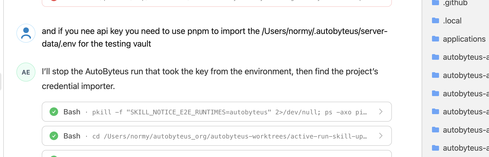

# Test Vault Developer Experience: Evaluation Report

Revision SR-006, 2026-10-19. The test vault is selected like a database (one environment variable). Approved by the user on 2026-10-19.
Worktree: `codex/test-vault-developer-experience` from `origin/personal` @ `d28c56d5d`.
Evidence: [investigation-notes.md](investigation-notes.md), raw logs in [walkthrough/](walkthrough/).
Requirements for approval: [requirements-doc.md](requirements-doc.md).

What changed since SR-001: the user's update of 2026-10-17 and the incident
screenshot (below) add one hard rule: **no key ever travels through the
environment, chat or logs**. The SR-001 recommendation is withdrawn because its
runner passed keys to tests as environment variables. The recommendation below
replaces it.

## 1. Bottom line

There is no standing test vault today. Every test database gets its own copy
of the user's real keys, and several test paths take keys straight from the
environment:

- **autobyteus-ts real-LLM tests never read a vault.** They read plain
  environment variables. 12 live test files are also stale: they crash with
  `TypeError` when a key is present, and when no key is present they skip and
  the run looks green.
- **Nine server live suites pull keys from the environment into their vault.**
  A shared helper, `initializeLiveRuntimeSecretVaultFromEnvironment`, copies
  *every* recognized `*_API_KEY` variable it finds into the test's vault. The
  suites that use it include Anthropic prompt caching, the DeepSeek
  collaborators, the runtime GraphQL suites and skill-update-notice.
- **Agent shells carry the user's production keys.** 13 plaintext `*_API_KEY`
  variables come from the live app's `~/.autobyteus/server-data/.env`. Neither
  autobyteus-ts nor the server E2E suites strip them. A live suite started in
  an agent shell therefore uses the production keys silently. That is the
  skill-update-notice incident.
- **The server real-provider E2E (`pnpm test:e2e:real`) uses a vault, but a
  hidden one per worktree** (`<worktree>/autobyteus-server-ts/db/test.db`). It
  must be provisioned again with `pnpm secrets:import` in every worktree.
  Agents can only do that with a sleep-timed `script` hack.

## 2. The incident (user evidence, 2026-10-17)

In the skill-update-notice ticket the user wrote: "if you need api key you need to
use pnpm to import the /Users/normy/.autobyteus/server-data/.env for the testing
vault". The agent had **already** started a live run that "took the key from the
environment", and it had to stop that run (`pkill -f "SKILL_NOTICE_E2E_RUNTIMES=autobyteus"`).

Cause, confirmed in code:
- `skill-update-notice-live.e2e.test.ts` says "AutoByteus takes provider keys
  from credential aliases in the environment".
- Its helper saves every `*_API_KEY` from `process.env` into the test vault.
- The agent shell already held the production keys.

The workaround the user had to give is itself the problem this task targets:
- the real `.env` is imported into yet another test database;
- the agent needs to know the importer, an absolute DB path and the TTY workaround.

Original screenshot: Task context file `ctx_b0352f9590d0__55.png`.

## 3. Walkthrough (2026-10-10)

| Step | Command (abbreviated) | Result | Time |
| --- | --- | --- | --- |
| 1 | Write an owner-only key file (`chmod 600`) with `DEEPSEEK_API_KEY`, `OPENAI_API_KEY` | OK. Group/world-readable files are rejected. | — |
| 2 | `pnpm secrets:import -- --source <abs> --database-url file:<abs>/test.db --dry-run` | OK, clear value-free plan | 23 s (rebuilds the server every call) |
| 3 | Same without `--dry-run`, no TTY | **Fails** `IMPORT_CONFIRMATION_REQUIRED`; piping `IMPORT` also fails | — |
| 4 | `echo IMPORT \| script -q /dev/null …` (TESTING.md recipe) | **Fails** `IMPORT_CANCELLED`: stdin EOF arrives before the prompt | — |
| 5 | `(sleep 6; printf 'IMPORT\r'; sleep 8) \| script -q /dev/null …` | Works | ~15 s |
| 6a | `pnpm -C autobyteus-ts test` | **Fails**: `Error: no test specified` | — |
| 6b | autobyteus-ts DeepSeek + OpenAI live tests, clean env | 12 skipped, exit 0; the vault is invisible | — |
| 6c | Same, inherited agent env | Uses **production** keys; 5/5 **crash** (`TypeError`) | — |
| 7 | `pnpm test:e2e:real:preflight` | Good per-scenario report. It silently uses `<worktree>/autobyteus-server-ts/db/test.db` (my vault ignored, path not printed). | 35 s |
| 8 | Import there, then `pnpm test:e2e:real -- --scenarios=deepseek.llm` | Scenario **passed** via the real server; run still **exits 1** (empty compaction suite) | 31 s |
| 9 | Cleanup | Manual `rm`; no command | — |

## 4. Findings

| ID | Area | Finding | Severity |
| --- | --- | --- | --- |
| F-01 | One way? | Four credential paths: • env vars (autobyteus-ts); • env → test vault helper (9 server live suites); • per-worktree vault via importer (`test:e2e:real`); • importer into each isolated instance DB. | High |
| F-02 | autobyteus-ts | 12 live test files are stale against the API-key-resolver contract and crash when a key is present. | High |
| F-03 | Isolation (Rule 2) | Agent shells inherit 13 plaintext production keys. Only the server unit/integration suites strip them. | High |
| F-04 | Reporting | Missing key → silent skip, exit 0. Provider 401/403/429/quota → the test **passes**. | High |
| F-05 | Docs vs code | `pnpm -C autobyteus-ts test` exits 1. | Medium |
| F-06 | Prompt | No supported non-interactive import. The documented `script` recipe fails; only sleep timing works. | High (agents) |
| F-07 | Location | Per-worktree hidden vault with an absolute path, never printed. Keys are re-copied per worktree and per isolated instance. Today 3 worktree test vaults exist, and `secrets:import` evidence appears in 143 ticket folders. | High |
| F-08 | Runner bug | A single non-compaction scenario run exits 1. | Medium |
| F-09 | Speed | Every importer/real-E2E call rebuilds the server (20–35 s). | Low |
| F-10 | Cleanup | No cleanup command; the test DB is created `0644`. | Low |
| F-11 | Discoverability | The flow is spread over 8 docs and the isolated-app skill. Nothing covers autobyteus-ts, and one autobyteus-ts doc still says "`.env.test` contains API keys". | Medium |
| F-12 | Leftovers in production data | Three earlier test-credential stores still sit in production app data; this repo's current code uses none of them: • `~/.autobyteus/local-vault/` (no reference in this repo); • `~/.autobyteus/server-data/secret-store/real-e2e-secret-store.{db,key}` from the removed "Dedicated Real-E2E Store" (replaced 2026-07-27); • `secret-store.{db,key}`. I did not open them. | Info / user decision |
| F-13 | Aliases | `QWEN_API_KEY`, `ZHIPU_API_KEY` and `GOOGLE_CSE_API_KEY` are silently ignored by the importer. | Low |
| F-14 | What works | Importer validation and value-free output, dry-run, the preflight capability report, deterministic-test isolation, and the server's vault-backed `ProviderApiKeyResolver`. | — |
| F-15 | Env → vault helper | `tests/e2e/helpers/live-runtime-secret-vault-helpers.ts` saves every recognized `*_API_KEY` from `process.env`. It is used by 9 live suites. Root cause of the incident. | High |
| F-16 | History | A "Dedicated Real-E2E Store" (a standing, read-only test store) existed until 2026-07-27. It was removed for two reasons: • it lived inside production app data; • the harness read it directly, so tests did not use the normal application vault lifecycle (secure-centralized-secret-provisioning ticket). The proposal below keeps that rule: each run works on a **copy** that the normal server opens. | Design input |

## 5. Recommended approach: one standing test vault that runs copy, no keys in the environment

**SR-003 refinement (user, 2026-10-19).** The test vault should feel like an API service:
- set up once;
- afterwards, any team member uses it the way it calls an API, with parameters in and a result out;
- nobody deals with vault mechanics;
- this applies to investigation and experiments by the solution designer or implementation engineer, not only to tests;
- the information lives in one global place every team member reads.

### 5.0 How it is used: like a test database

The user (2026-10-19): "the user just sets this environment variable … for the test
server, for the integration test, for API E2E … the electron instance … it's good
to go. And production, if you don't set this, it by default uses the production
itself."

| | Database (industry standard) | Vault (this design) |
| --- | --- | --- |
| Selector | `DATABASE_URL` | `AUTOBYTEUS_TEST_VAULT` (a directory; never a key) |
| Unset | the app's own database | the vault inside the app's own database (today's production behavior) |
| Set | every query goes to the test database | every key lookup reads the test vault (read-only) |
| Code changes | none | none: server code unchanged; autobyteus-ts uses a default key source that its test setup installs |

| Who / when | What they do |
| --- | --- |
| User, once per machine | `pnpm test-vault setup --source <secrets file>`. It prints `export AUTOBYTEUS_TEST_VAULT=~/.autobyteus-test/vault`. |
| Server integration / API-E2E tests, test servers, `pnpm test:e2e:real` | Set `AUTOBYTEUS_TEST_VAULT` (and the test's `RUN_*` gate); run as usual |
| Isolated Electron instance | Set `AUTOBYTEUS_TEST_VAULT`; `pnpm isolated-app start …` |
| autobyteus-ts tests and investigation scripts | Set `AUTOBYTEUS_TEST_VAULT`; `LLMFactory.createLLM('deepseek-v4-flash')` or `new DeepSeekLLM(model, config)` just works |
| Anyone | `pnpm test-vault status` (location, configured/missing providers) |

Safety:
- the test vault is opened read-only; a Settings save while it is selected is refused;
- a server on your real app data (`~/.autobyteus/server-data`) ignores the variable even if inherited;
- every server logs which vault it uses;
- paid live tests still need their `RUN_*` gate.

**Where the knowledge lives.** A short `AGENTS.md` entry (loaded by every agent) and one TESTING.md section, both saying the same thing: "set `AUTOBYTEUS_TEST_VAULT`".

### 5.1 Details

What the user and agents need to know:

> The test vault is at `~/.autobyteus-test/vault/`, or wherever `AUTOBYTEUS_TEST_VAULT` points.
> Create it once with `pnpm test-vault:setup --source <secrets file>`.
> Live tests use it automatically when their `RUN_*` gate is set.

1. **Standing test vault, created once.**
   - `pnpm test-vault:setup --source <owner-private secrets file>` is one non-interactive command:
     - it prints a value-free summary and the vault path;
     - it needs no database URL and no prompt;
     - `--replace` overwrites configured keys.
   - The target is always the test vault, never a user-chosen database. That is why the TTY challenge is no longer needed.
   - `pnpm test-vault:status` lists the path and configured/missing secret IDs.
   - `pnpm test-vault:remove` deletes the DB/key pair.
   - Tooling refuses any vault location inside `~/.autobyteus` or the OS app-data folders.
2. **Tests find it automatically, and each run uses a copy.**
   - The harness copies the encrypted DB+key pair into the run-owned data folder. The normal server opens that copy through its usual startup lifecycle.
   - Tests never write to or migrate the standing vault.
   - This applies to `test:e2e:real`, the 9 gated server live suites and isolated test instances (`isolated-app start --test-vault`).
3. **autobyteus-ts live tests read the vault in-process.**
   - A test-only resolver opens a run copy of the test vault with the server's existing vault code. It decrypts each key at the point of use, inside the test process.
   - autobyteus-ts itself stays storage-neutral.
   - The stale tests are repaired to use this resolver.
4. **No key in the environment.**
   - The env → vault helper is removed.
   - Live tests ignore and strip inherited `*_API_KEY` variables, so production keys cannot reach a test.
   - Gates (`RUN_*`) and the vault *location* are the only test inputs.
5. **Missing capability is visible.**
   - With the gate on, an absent key is reported as `missing capability <secret id> (test vault <path>)`, and a provider refusal as a classified reason (invalid key, quota, rate limit, model access).
   - Neither is ever counted as passed; `--strict` turns them into failures.
6. **Safe by default.** Live tests stay explicit opt-in; values are never printed (canary-scan tests); the user's real vault, `.env` and app data are never opened by test tooling.
7. **One message in docs and skills.**
   - `AGENTS.md` (loaded by every agent) gets a three-line "Test vault" entry.
   - TESTING.md gets one "Real-provider tests and the test vault" section.
   - secret_management.md, the server README, the isolated-app guide, the isolated-app skill and the test-running team skills point to it.
   - The `script` workaround and per-database import instructions for tests are removed.
8. **Also fixed:**
   - `pnpm -C autobyteus-ts test` runs and is credential-free;
   - the single-scenario exit bug;
   - the preflight prints the vault path.

The general `pnpm secrets:import` stays as it is (explicit target, TTY) for production and other explicit databases. Tests no longer need it.

### Trade-offs

- (+) Set up once per machine; no per-test or per-run import; one thing to tell agents; no key in env, chat or logs; standing vault never mutated; same vault lifecycle as the app (the reason the old test store was removed).
- (−) It reverses the documented rule "no test wrapper / never a test-runner fallback" (secret_management.md). That needs your approval.
- (−) autobyteus-ts live tests need the built server's vault code through a workspace `test-support` module, a test-only dependency in the reverse direction. The alternative is extracting a small shared vault-reader package, which is a bigger refactor. I will choose in design.
- (−) Medium-to-large: setup tooling, harness copy, replacing the helper in 9 suites, repairing about 14 autobyteus-ts files, the isolated-app option, docs and skills.
- Keys still exist decrypted in the test process memory at the moment of use. That is unavoidable, and it is the same as in the product.

### Alternatives (not recommended)

- **B — standing plaintext key file instead of a vault:** simpler, but keys stay plaintext at rest. It is not the vault you asked for.
- **C — keep per-database import and only fix the scripts:** small, but keys keep being copied into many databases.

## 6. Decisions (all decided within the user's direction on 2026-10-19; reasoning in requirements-doc § Decisions)

| ID | Question | Recommendation |
| --- | --- | --- |
| DEC-001 | Approve the approach in §5 (standing vault, copy per run, in-process resolver, no keys in env), including reversing the "no test wrapper" rule for the **test** vault only? | Yes |
| DEC-002 | Location: whatever `AUTOBYTEUS_TEST_VAULT` says, and `~/.autobyteus-test/vault/` when it is unset? | Yes |
| DEC-003 | Setup source: any owner-private file you name explicitly, read once and never modified (it could be `~/.autobyteus/server-data/.env`), or a dedicated test-keys file only? | Any file you name. Docs recommend a dedicated file. |
| DEC-004 | Remove all env-sourced keys from tests (the helper is removed, aliases ignored, inherited keys stripped)? This changes how today's live suites are started: no more `ANTHROPIC_API_KEY=… vitest …`. | Yes |
| DEC-005 | Repair all stale autobyteus-ts live provider tests in this task? | Yes (~14 files) |
| DEC-006 | Absent key or provider refusal: a skip with a reason plus `--strict`, or always a failure? | Skip with a reason + `--strict` |
| DEC-007 | Include `isolated-app start --test-vault` (isolated instances get a copy instead of an import)? | Yes |
| DEC-009 | Shell `ask` command and global knowledge placement | Decided 2026-10-19: no `ask` command (the user rejected it); code API only; `AGENTS.md` entry + TESTING.md section |
| DEC-008 | Old stores in production data (`~/.autobyteus/local-vault`, `server-data/secret-store/real-e2e-secret-store.*`) and the 3 worktree test DBs with copied keys: leave untouched and list them for you to delete, or include a guided cleanup? | Leave them; I list them and you delete them |

Out of scope:
- CLI-login runtimes (Claude, Codex, AGY, Grok);
- production vault behavior;
- importer aliases (document the rename instead).

I also recommend, separately from this task, that you remove the plaintext keys from `~/.autobyteus/server-data/.env` once Settings holds them, because the live app exports them into every agent shell.
